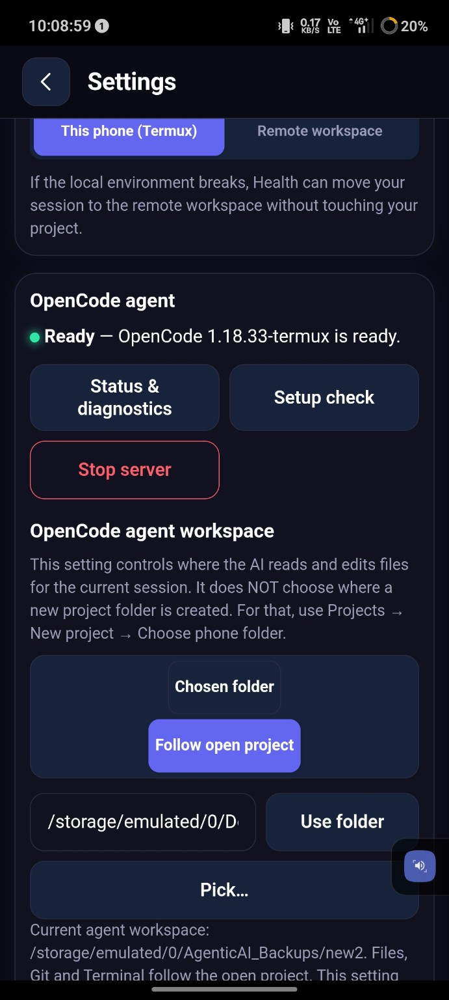
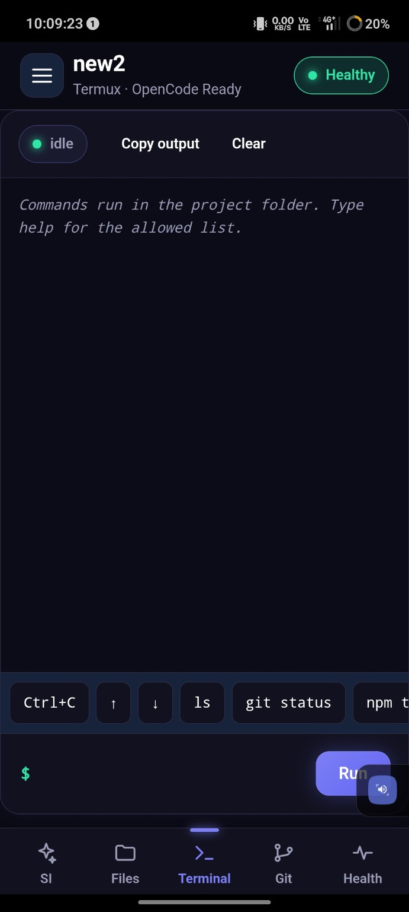
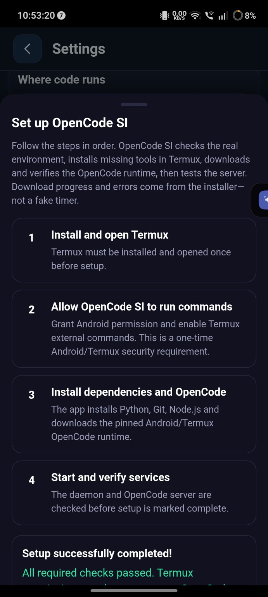
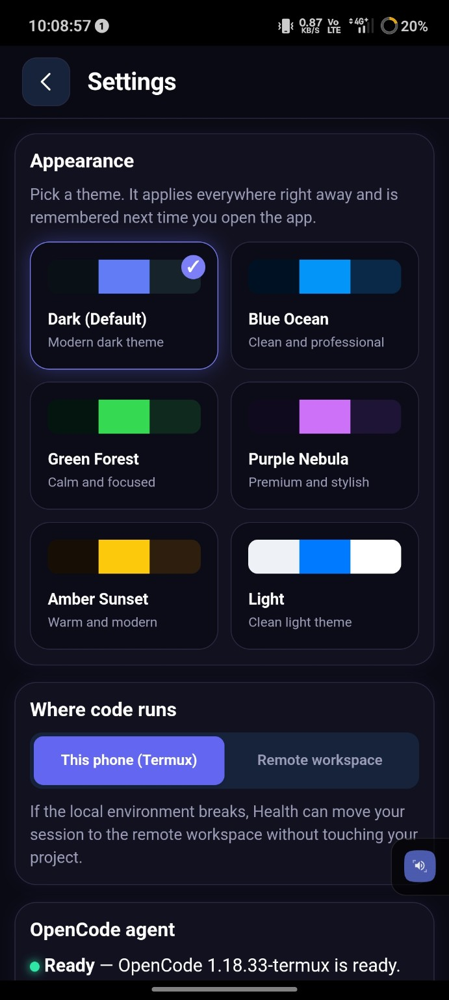
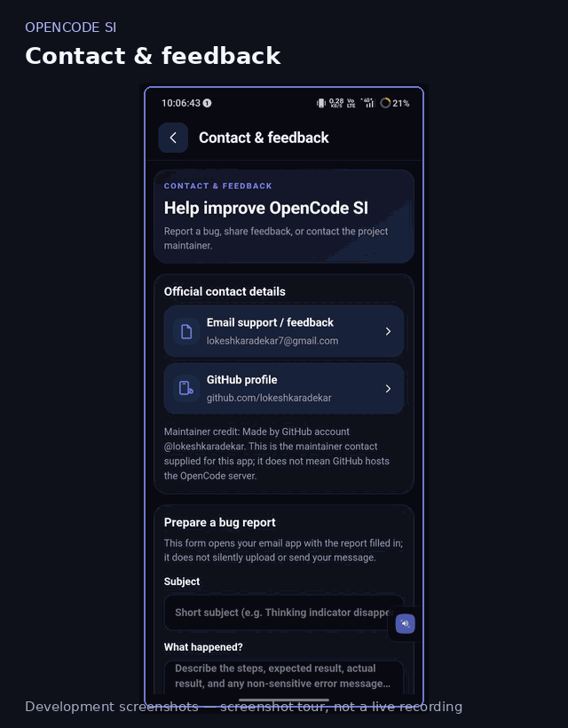

<div align="center">


# OpenCode SI

### Android app for AI-assisted coding

**A mobile WebView interface for working with the OpenCode coding agent, project files, terminal commands, and Git—with local runtime support through Termux.**

<p>
  
  
  
  
</p>

[Download APK](#download-android-apk) · [Features](#features) · [Screenshots](#screenshots) · [Installation](docs/INSTALLATION.md) · [Troubleshooting](docs/REPAIR_NOTES.md)

</div>

---

## About

**OpenCode SI is an Android app project** that provides a mobile interface for an AI coding agent. Its interface is built with a WebView and native Java bridge. Termux supplies the local command-line environment and runs the supporting services.

This repository includes an APK file named **`Opencode Si.apk`**, along with the app source and documentation. The APK is present in the repository, but its build provenance, internal version, and successful installation on a physical Android device have **not** been independently verified here. The source package version shown above is from `package.json`; it must not be assumed to be the APK's version.

> **Project status: Prototype.** Automated tests cover portions of the frontend, daemon, and Java logic. Full Android/Sketchware integration and real-device workflows still require validation. See [Implementation Status](docs/STATUS.md).

## Download Android APK

<div align="center">


### OpenCode SI — Android APK

**Package file:** `Opencode Si.apk`  
**Repository file size:** approximately 768 KB  
**Distribution:** APK file included in this Git repository

[**↓ Download Opencode Si.apk**](Opencode%20Si.apk)

</div>

The APK is a repository download, not a Google Play Store release. Android compatibility and the APK's internal version have not been certified. If installation is blocked, review the [installation guide](docs/INSTALLATION.md) and [Android support notes](docs/ANDROID_SUPPORT.md).

Only install APKs from sources you trust. Review Android's installation and permission prompts before proceeding.

## Project overview

| Item | Details |
|---|---|
| App type | Android application / APK |
| Interface | Android WebView with native Java bridge |
| Local runtime | Termux |
| Coding agent service | OpenCode server |
| Supporting service | Python daemon |
| Source package version | `0.4.2` (`package.json`; not verified as the APK version) |
| Android build workflow | Sketchware Pro source import is documented |
| Device validation | Not certified across Android devices |
| License | No project license selected yet |

## Features

The repository source documents these capabilities:

- **AI coding interface** — start and continue OpenCode sessions, with Build and Plan modes when supported by the installed configuration.
- **Project workspace** — choose a workspace and browse project files.
- **Terminal integration** — run commands through a persistent pseudo-terminal, stream output, send input, and cancel supported commands.
- **File management** — list, read, write, create, rename, search, and delete files through the daemon API.
- **Git tools** — inspect status, diffs, history, and branches, and use supported Git operations.
- **Snapshots and undo** — create snapshots and restore project state where the relevant flow is available.
- **Setup and diagnostics** — check local services and runtime health, and use manual setup instructions if automatic setup fails.
- **Settings and themes** — configure supported interface and workspace options.

**Important:** These are capabilities described by the source, not a promise that every feature works on every Android device. Check [Implementation Status](docs/STATUS.md) for tested, partial, and unverified areas.

## Screenshots

The images below are screenshots included in this repository.

<div align="center">

| Workspace | Terminal / status |
|---|---|
|  |  |

| Setup help | Settings |
|---|---|
|  |  |

</div>

A short screenshot tour is available here:



*The GIF is a screenshot tour, not a screen recording or proof of end-to-end operation.*

## How it works

```text
OpenCode SI Android app
        │
        ▼
WebView interface + native Java bridge
        │
        ├── OpenCode server client
        │
        └── Termux command integration
                     │
                     ▼
          Python daemon in Termux
          Files · Terminal · Git · Snapshots · Health
```

The APK does not itself imply that a complete Linux shell or the OpenCode runtime is bundled inside it. The documented setup uses Termux for the local runtime.

## Requirements and device support

- Android device; Android 8.0 or newer is recommended by the project documentation.
- ARM64 is required for the documented OpenCode Termux binary.
- Termux from F-Droid or the official Termux GitHub releases.
- Sketchware Pro for the documented source-import/build route.
- Network access for package installation and any remote AI model provider.

Compatibility has not been systematically validated across devices and Android versions. See [Android Support](docs/ANDROID_SUPPORT.md).

## Installation

For the documented setup route:

1. Read the [Installation Guide](docs/INSTALLATION.md).
2. Follow the [Sketchware Pro setup notes](docs/SKETCHWARE_SETUP.md) if importing/building from source.
3. Install and open Termux, then follow the app's setup checks.
4. Use **Check again** and confirm the required health checks pass before relying on the agent.

If setup fails, see [Troubleshooting](docs/REPAIR_NOTES.md).

## Development checks

Run these from the project root in an environment with the required tools installed:

```bash
npm test
npm run build
```

Passing source tests does not prove the APK installs or that all flows work on a physical Android device.

## Documentation

- [Documentation index](docs/README.md)
- [Installation](docs/INSTALLATION.md)
- [Android support](docs/ANDROID_SUPPORT.md)
- [Implementation status](docs/STATUS.md)
- [OpenCode integration](docs/OPENCODE.md)
- [Daemon guide](docs/DAEMON.md)
- [Sketchware setup](docs/SKETCHWARE_SETUP.md)
- [Roadmap](docs/ROADMAP.md)
- [Repair notes](docs/REPAIR_NOTES.md)
- [Security policy](SECURITY.md)
- [Contribution guide](CONTRIBUTING.md)

## Independence

OpenCode SI is an independent project and is not developed by, endorsed by, or affiliated with the OpenCode team. OpenCode is a separate upstream project.

## License

A project license has not yet been selected in this repository. Until a license is added, do not assume the source is licensed for unrestricted reuse or redistribution.
